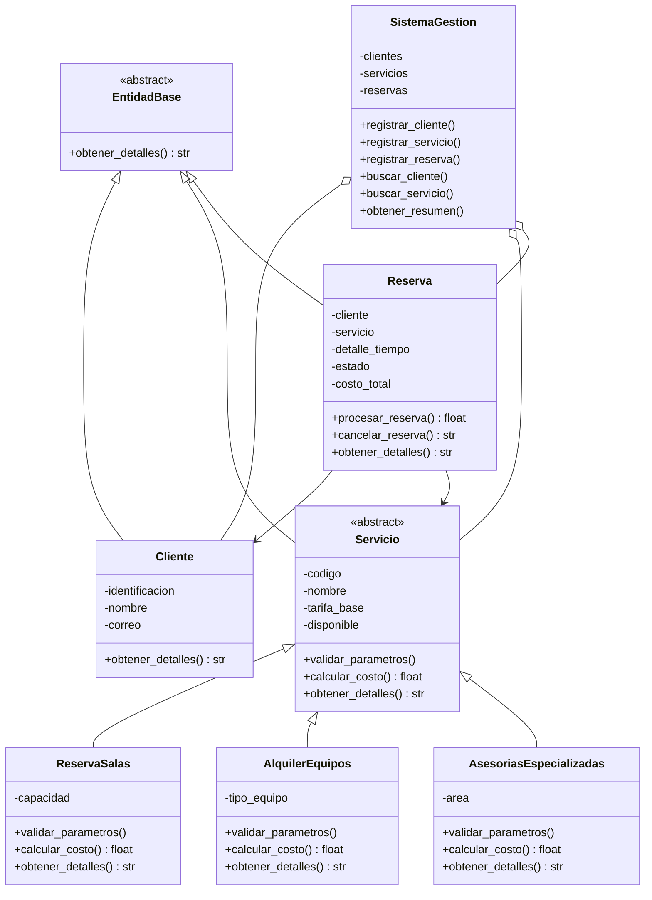

# Software FJ — Sistema Integral de Gestión de Clientes, Servicios y Reservas

[](https://www.python.org/)
[](https://www.unad.edu.co/)
[](#alcance-y-limitaciones)

Aplicación de consola desarrollada en Python para simular la gestión integral de clientes, servicios y reservas de **Software FJ**. El proyecto aplica los principios de programación orientada a objetos, validaciones de datos y manejo avanzado de excepciones. La información se administra en memoria mediante objetos y listas, sin utilizar motores de bases de datos.

**Contexto académico:** Universidad Nacional Abierta y a Distancia (UNAD), programa Ingeniería de Sistemas, curso Programación, código 213023, Fase 4.

---

## Tabla de contenido

- [1. Objetivo del proyecto](#1-objetivo-del-proyecto)
- [2. Alcance funcional](#2-alcance-funcional)
- [3. Arquitectura del proyecto](#3-arquitectura-del-proyecto)
- [4. Diagrama de clases](#4-diagrama-de-clases)
- [5. Principios de programación orientada a objetos](#5-principios-de-programación-orientada-a-objetos)
- [6. Manejo de excepciones y registro de eventos](#6-manejo-de-excepciones-y-registro-de-eventos)
- [7. Reglas de cálculo de los servicios](#7-reglas-de-cálculo-de-los-servicios)
- [8. Requisitos previos](#8-requisitos-previos)
- [9. Instalación y ejecución](#9-instalación-y-ejecución)
- [10. Operaciones de simulación](#10-operaciones-de-simulación)
- [11. Estructura del repositorio](#11-estructura-del-repositorio)
- [12. Posibilidades de ampliación](#12-posibilidades-de-ampliación)
- [13. Alcance y limitaciones](#13-alcance-y-limitaciones)
- [14. Equipo de trabajo](#14-equipo-de-trabajo)
- [15. Referencias bibliográficas](#15-referencias-bibliográficas)

---

## 1. Objetivo del proyecto

Desarrollar un sistema integral orientado a objetos que permita representar y gestionar los procesos de registro de clientes, administración de servicios y procesamiento de reservas de la empresa ficticia Software FJ.

La solución busca demostrar la aplicación de los fundamentos de programación orientada a objetos mediante una arquitectura modular, organizada y extensible, incorporando abstracción, herencia, encapsulación, polimorfismo, validaciones estrictas y manejo avanzado de excepciones.

Asimismo, se busca garantizar que la aplicación pueda gestionar situaciones de error de manera controlada, registrar los eventos relevantes y continuar ejecutando las operaciones posteriores sin interrumpir toda la simulación.

## 2. Alcance funcional

El sistema contempla las siguientes funcionalidades:

- Registro de clientes mediante identificación, nombre y correo electrónico, con validaciones de datos.
- Administración de servicios de reserva de salas, alquiler de equipos y asesorías especializadas.
- Cálculo de costos de acuerdo con las características y parámetros de cada servicio.
- Creación, procesamiento y cancelación de reservas.
- Asociación de clientes con los servicios correspondientes.
- Administración de clientes, servicios y reservas mediante listas internas en memoria.
- Validación de parámetros y detección de operaciones no permitidas.
- Implementación de excepciones personalizadas para identificar diferentes tipos de errores.
- Registro de eventos, advertencias y errores mediante el módulo `logging`.
- Ejecución de diez operaciones de simulación para demostrar el funcionamiento del sistema ante escenarios correctos e incorrectos.

La aplicación funciona mediante una interfaz de consola. No incorpora interfaz gráfica, almacenamiento persistente de clientes o reservas ni conexión con servicios externos.

## 3. Arquitectura del proyecto

El proyecto está organizado en módulos independientes, cada uno con responsabilidades específicas para facilitar el mantenimiento, la comprensión y la ampliación del sistema.

| Archivo | Responsabilidad |
|---|---|
| `main.py` | Punto de entrada de la aplicación. Configura el registro de eventos, coordina las diez operaciones de simulación, controla las excepciones y presenta el resumen final. |
| `modelos.py` | Contiene las clases abstractas, clientes, servicios especializados, reservas y la clase administradora `SistemaGestion`. Implementa las validaciones y la lógica de negocio. |
| `excepciones.py` | Define la jerarquía de excepciones personalizadas utilizadas para controlar los errores del sistema. |
| `README.md` | Contiene la documentación general, la arquitectura y las instrucciones de instalación y ejecución. |
| `sistema_fj.log` | Archivo generado automáticamente durante la ejecución para almacenar eventos, advertencias y errores. |

La separación por módulos permite mantener una estructura organizada y evita concentrar todas las funcionalidades en un único archivo.

## 4. Diagrama de clases

El siguiente diagrama representa la arquitectura general del sistema y las relaciones entre sus principales componentes.



**Interpretación del diagrama:**

- `EntidadBase` establece una estructura abstracta para las entidades principales.
- `Servicio` define el comportamiento común de los servicios ofrecidos.
- Las tres clases especializadas heredan de `Servicio` e implementan sus propias reglas.
- `Reserva` relaciona un cliente con un servicio y administra el estado de la operación.
- `SistemaGestion` mantiene las colecciones de clientes, servicios y reservas en memoria.

## 5. Principios de programación orientada a objetos

### 5.1. Abstracción

La abstracción permite definir estructuras generales que establecen los comportamientos que deben implementar las clases derivadas.

En el proyecto se implementa mediante:

- `EntidadBase`: clase abstracta que establece el método `obtener_detalles()`.
- `Servicio`: clase abstracta que define los métodos `validar_parametros()`, `calcular_costo()` y `obtener_detalles()`.

Estas clases establecen contratos de comportamiento que deben respetar sus clases especializadas.

### 5.2. Herencia

La herencia permite reutilizar atributos y comportamientos definidos en clases superiores.

En Software FJ se implementa de la siguiente manera:

- `Cliente`, `Servicio` y `Reserva` heredan de `EntidadBase`.
- `ReservaSalas`, `AlquilerEquipos` y `AsesoriasEspecializadas` heredan de `Servicio`.

Esto permite mantener una estructura jerárquica y facilitar la incorporación de nuevos tipos de servicios.

### 5.3. Encapsulación

La encapsulación permite proteger los atributos internos de los objetos y controlar el acceso a ellos.

El proyecto utiliza atributos privados y protegidos, junto con propiedades implementadas mediante `@property` y sus respectivos métodos `setter`, para realizar validaciones antes de asignar determinados valores.

Por ejemplo, la clase `Cliente` valida la identificación, el nombre y el correo electrónico antes de almacenar la información en sus atributos internos.

La clase `Reserva` también controla el acceso a su estado y a los datos relacionados con el procesamiento de la operación.

### 5.4. Polimorfismo

El polimorfismo permite utilizar una misma interfaz para ejecutar comportamientos diferentes según el tipo de objeto.

En el proyecto, las clases `ReservaSalas`, `AlquilerEquipos` y `AsesoriasEspecializadas` implementan sus propias versiones de los métodos:

- `validar_parametros()`
- `calcular_costo()`
- `obtener_detalles()`

La clase `Reserva` utiliza el método `calcular_costo()` a través de una referencia general a `Servicio`, sin necesidad de conocer los detalles internos de cada implementación especializada.

### 5.5. Parámetros opcionales y variantes de cálculo

Python no implementa la sobrecarga tradicional de métodos por firma como algunos otros lenguajes de programación.

Para demostrar diferentes modalidades de cálculo, el proyecto utiliza parámetros opcionales y argumentos variables.

Algunos ejemplos son:

- Reserva de salas: permite aplicar descuentos y decidir si se incluye el factor de impuesto.
- Alquiler de equipos: permite incorporar un seguro opcional.
- Asesorías especializadas: permite calcular tarifas según el nivel de experticia.

Esta implementación permite adaptar las operaciones de cálculo a las condiciones particulares de cada servicio.

## 6. Manejo de excepciones y registro de eventos

El manejo de excepciones es uno de los componentes fundamentales del proyecto.

El sistema utiliza una jerarquía de excepciones personalizadas, definida en `excepciones.py`, con `SoftwareFJError` como clase principal.

Las excepciones especializadas permiten identificar y controlar situaciones particulares:

| Excepción | Descripción |
|---|---|
| `SoftwareFJError` | Excepción base del sistema. |
| `ClienteInvalidoError` | Errores relacionados con los datos de los clientes. |
| `ServicioInvalidoError` | Errores en los parámetros o características de los servicios. |
| `ServicioNoDisponibleError` | Intentos de utilizar servicios que no se encuentran disponibles. |
| `ReservaError` | Errores generales durante la gestión de reservas. |
| `ReservaCanceladaError` | Intentos de operar sobre una reserva previamente cancelada. |
| `EstadoReservaInvalidoError` | Operaciones no permitidas según el estado de la reserva. |
| `CalculoCostoError` | Errores inesperados durante los cálculos de costos. |

### Estructuras de control de excepciones

El sistema utiliza diferentes mecanismos de manejo de excepciones:

- `try/except`: permite capturar y controlar errores durante la ejecución.
- `try/except/else`: permite ejecutar instrucciones adicionales cuando una operación termina correctamente.
- `try/except/finally`: garantiza la ejecución de acciones de cierre o registro independientemente del resultado.
- Encadenamiento de excepciones: utiliza `raise ... from error` para conservar la causa original de un error inesperado.

### Registro de eventos mediante logging

El módulo `logging` permite registrar la actividad del sistema en el archivo `sistema_fj.log`.

Se registran eventos como:

- Inicialización del sistema.
- Registro de clientes y servicios.
- Creación y procesamiento de reservas.
- Confirmación y cancelación de operaciones.
- Advertencias y errores de validación.
- Excepciones inesperadas y sus causas.
- Finalización de las operaciones de simulación.

La configuración centralizada del registro se realiza desde `main.py`, mientras que los demás módulos utilizan sus respectivos objetos `logger`.

Para generar el archivo de registros, es necesario ejecutar la aplicación desde `main.py`.

## 7. Reglas de cálculo de los servicios

Cada tipo de servicio implementa sus propias reglas de cálculo, teniendo en cuenta los parámetros recibidos y las validaciones correspondientes.

| Servicio | Parámetros | Regla de cálculo |
|---|---|---|
| Reserva de salas | Horas, descuento e indicador de impuesto. | Tarifa base × horas × (1 − descuento). Si se solicita, se aplica un factor adicional de 1.19. |
| Alquiler de equipos | Días y opción de seguro. | Tarifa base × días. Si se selecciona el seguro, se agregan $15.000 por cada día. |
| Asesoría especializada | Sesiones y nivel de experticia. | Tarifa base × sesiones × multiplicador según el nivel seleccionado. |

### Multiplicadores de asesoría

| Nivel de experticia | Multiplicador |
|---|---:|
| Junior | 1.00 |
| SemiSenior | 1.25 |
| Senior | 1.50 |

**Nota:** los valores, factores y porcentajes anteriores son parámetros definidos en el código para la simulación académica. No deben interpretarse como una cotización comercial ni como una determinación tributaria aplicable a una operación real.

## 8. Requisitos previos

Para ejecutar el proyecto se requiere:

- Python 3.8 o una versión posterior.
- Git, en caso de realizar la descarga mediante clonación del repositorio.
- Un editor de código o terminal para ejecutar la aplicación.

El proyecto utiliza exclusivamente módulos de la biblioteca estándar de Python, entre ellos:

- `abc`
- `logging`
- `math`
- `re`
- `pathlib`

No es necesario instalar paquetes externos para ejecutar la simulación descrita.

## 9. Instalación y ejecución

### 9.1. Clonar el repositorio

Abrir una terminal y ejecutar:

```bash
git clone https://github.com/job524/SoftwareFJ_Gestion_Clientes_Servicios_Reservas.git
```

### 9.2. Ingresar al directorio del proyecto

```bash
cd SoftwareFJ_Gestion_Clientes_Servicios_Reservas
```

### 9.3. Ejecutar la aplicación

En Windows:

```powershell
python main.py
```

En macOS o Linux:

```bash
python3 main.py
```

### 9.4. Consultar los resultados

Al ejecutar el programa, la consola presenta:

- El desarrollo de cada una de las diez operaciones.
- Los resultados correctos.
- Las excepciones controladas.
- El estado de cada operación.
- El resumen general de clientes, servicios y reservas.
- El balance final de la simulación.

### 9.5. Consultar los registros

El archivo `sistema_fj.log` se crea o actualiza automáticamente en el directorio del proyecto.

Este archivo permite consultar los eventos y errores registrados durante la ejecución.

No es necesario crear el archivo manualmente.

## 10. Operaciones de simulación

El archivo `main.py` incorpora diez escenarios de prueba para demostrar el funcionamiento del sistema, incluyendo registros válidos e inválidos, procesamiento de servicios y manejo de errores.

| N.º | Escenario | Resultado esperado |
|---:|---|---|
| 1 | Registro de un cliente válido y procesamiento de una reserva de sala con descuento e impuesto. | Operación correcta. |
| 2 | Intento de registrar un cliente con identificación no numérica. | Excepción de cliente controlada. |
| 3 | Registro de un cliente y alquiler de equipos tecnológicos con seguro. | Operación correcta. |
| 4 | Registro y procesamiento de una asesoría especializada con nivel Senior. | Operación correcta. |
| 5 | Intento de crear una reserva con duración negativa. | Excepción de reserva controlada. |
| 6 | Intento de registrar un cliente con correo electrónico inválido. | Excepción de cliente controlada. |
| 7 | Intento de crear un servicio con tarifa negativa. | Excepción de servicio controlada. |
| 8 | Intento de procesar una asesoría con un nivel de experticia no permitido. | Excepción de servicio controlada. |
| 9 | Cancelación de una reserva previamente confirmada. | Operación correcta. |
| 10 | Creación y procesamiento de una nueva reserva después de los escenarios de error. | Operación correcta. |

La función `ejecutar_operacion()` permite ejecutar cada escenario de manera independiente, capturando las excepciones del sistema y los errores inesperados.

De esta manera, un error individual no debe impedir la continuación de las siguientes operaciones.

### Resultado esperado

De acuerdo con los escenarios programados, se esperan los siguientes resultados:

| Indicador | Cantidad esperada |
|---|---:|
| Total de operaciones | 10 |
| Operaciones correctas | 5 |
| Errores controlados | 5 |
| Errores inesperados | 0 |

Estos valores representan los resultados previstos para los escenarios descritos. Deben verificarse mediante la ejecución de la versión definitiva del proyecto en el entorno de entrega.

## 11. Estructura del repositorio

La organización general del proyecto es la siguiente:

```text
SoftwareFJ_Gestion_Clientes_Servicios_Reservas/
│
├── README.md
│
├── excepciones.py
│
├── modelos.py
│
├── main.py
│
└── sistema_fj.log
```

**Descripción de los archivos:**

- `README.md`: documentación general del proyecto.
- `excepciones.py`: definición de las excepciones personalizadas.
- `modelos.py`: implementación de las entidades, clientes, servicios, reservas y administrador del sistema.
- `main.py`: configuración, ejecución y simulación de las operaciones.
- `sistema_fj.log`: archivo generado durante la ejecución.

El archivo de registros se genera automáticamente y puede no estar presente en un clon recién descargado.

## 12. Posibilidades de ampliación

La arquitectura del sistema permite incorporar nuevas funcionalidades y tipos de servicios sin tener que modificar completamente su estructura.

### Incorporación de un nuevo servicio

Para agregar un nuevo tipo de servicio se deben seguir estos pasos:

1. Crear una clase que herede de `Servicio` en `modelos.py`.
2. Implementar los métodos `validar_parametros()`, `calcular_costo()` y `obtener_detalles()`.
3. Definir y validar los atributos específicos del nuevo servicio.
4. Crear una instancia del servicio y registrarla mediante `SistemaGestion.registrar_servicio()`.
5. Incorporar escenarios adicionales en `main.py` para comprobar su funcionamiento.

### Incorporación de nuevas excepciones

Cuando se requiera controlar una nueva condición de error, se recomienda definir una excepción específica en `excepciones.py`.

Esta debe heredar de `SoftwareFJError` o de la categoría correspondiente para conservar la jerarquía de excepciones del sistema.

## 13. Alcance y limitaciones

Este desarrollo corresponde a un prototipo académico orientado a demostrar los fundamentos de programación orientada a objetos y el manejo avanzado de excepciones.

Es importante considerar las siguientes limitaciones:

- Los datos de clientes, servicios y reservas se mantienen en memoria y se pierden al cerrar el programa.
- No se utiliza ningún motor de bases de datos.
- El archivo de logs conserva los eventos de ejecución, pero no reemplaza un sistema de almacenamiento persistente.
- No incorpora autenticación ni administración de permisos de usuarios.
- No dispone de interfaz gráfica.
- No contempla pagos electrónicos ni integración con plataformas externas.
- Los datos utilizados en la simulación son ejemplos ficticios.
- No debe utilizarse información personal real en el repositorio público.

Para considerar el sistema en un entorno productivo sería necesario desarrollar mecanismos de persistencia, implementar pruebas automatizadas, realizar revisiones de seguridad y validar las reglas comerciales y operativas.

## 14. Equipo de trabajo

**Institución:** Universidad Nacional Abierta y a Distancia (UNAD).

**Programa:** Ingeniería de Sistemas.

**Curso:** Programación.

**Código del curso:** 213023.

**Actividad:** Fase 4 — Sistema Integral de Gestión de Clientes, Servicios y Reservas.

### Integrantes

| N.º | Integrante | Participación |

 1  José Orlando Buitrago Riveros | Desarrollo inicial y creación del repositorio del proyecto. 
 2  Edison Castañeda García | Desarrollo, fortalecimiento y documentación de los módulos del proyecto. 


Tutor: Manuel Mejía Muñoz.

Los nombres y las participaciones de los integrantes restantes deben completarse con la información confirmada por el equipo.

## 15. Referencias bibliográficas

Universidad Nacional Abierta y a Distancia. (s. f.). *Anexo 3: Problema a desarrollar Fase 4* [Guía de actividad del curso Programación, código 213023]. UNAD.

Python Software Foundation. (s. f.). *abc — Abstract Base Classes*. Python Documentation. https://docs.python.org/3/library/abc.html

Python Software Foundation. (s. f.). *logging — Logging facility for Python*. Python Documentation. https://docs.python.org/3/library/logging.html

Python Software Foundation. (s. f.). *Errors and exceptions*. The Python Tutorial. https://docs.python.org/3/tutorial/errors.html

---

## Repositorio oficial del proyecto

[SoftwareFJ_Gestion_Clientes_Servicios_Reservas — GitHub](https://github.com/job524/SoftwareFJ_Gestion_Clientes_Servicios_Reservas)

Este repositorio contiene el desarrollo del sistema Software FJ realizado como parte de la actividad académica de la Fase 4 del curso Programación de la UNAD.
